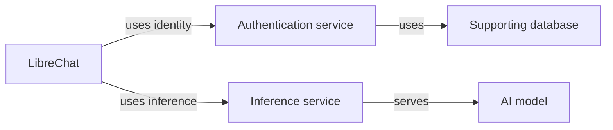

# AI Surface Model

An open model which surfaces the connected components, configuration and
relationships of an AI system, at the level of detail available or useful.

There is one model: the **AI Surface Model**. Lab, Experiment and related
descriptions are **fragments** within it. Each fragment describes a focused part
of the system or its context using the same model.

**Status: early conceptual draft.** This repository contains the project scope,
draft concepts, synthetic examples and interoperability research questions.
There is no released schema, validator, exporter or deployment engine yet.

The [experimental Researcher contracts](docs/n8r-surface/contracts.md) now have
a TypeScript library and [synthetic acceptance cases](examples/researcher/README.md)
for HTML research records and selected partial definitions in JSON/YAML. These
bounded checks are not universal model conformance. An experimental
[bare-startup command](docs/n8r-surface/startup.md) now shows local settings and
artefacts without changing files. Setup, other commands, source-repository
analysis and the AI Researcher workflow remain subsequent work; see the
[critical path](docs/n8r-surface/critical-path.md).

The [n8r-surface Researcher skill package](docs/n8r-surface/researcher-skill.md) is now
available for testing in the existing Codex/ChatGPT harness. It uses the host's
source access and conversation to produce evidence-backed working notes. The
[discovery guide](docs/n8r-surface/researcher-discovery.md) focuses on AI-relevant
graphs, reusable product knowledge and comparing descriptions with evidence. See
[verification and pending Work-mode checks](docs/n8r-surface/researcher-skill-verification.md).
The delivery order is skill first, n8r-labs adaptation second, standalone CLI third.
The [local vault](docs/n8r-surface/researcher-vault.md) holds research notes, intermediate artifacts
and Surface descriptions at a user-selected local path. It also includes prepared test material
and a walkthrough for investigating another chat-system repository.

The [command intent and verification spec](docs/n8r-surface/command-outcomes.md)
defines the proposed commands, user outcomes and evidence required before claiming
that those workflows work.

An AI Surface can include applications, agents, models, inference services,
authentication, tools, data stores, supporting infrastructure and the connections
between them. Descriptions can grow from a few known components into a detailed
representation of a complete setup. Different parts can have different depths.

## What the model is for

- Investigate saved Surfaces offline, including which contain a particular
  component and version, with explicit coverage limits.
- Remember equipment and integration configuration for Lab and Experiment setups.
- Bind Experiment results to the Surface revision and effective setup tested.
- Connect provenance and history across lab, development and production services.
- Share setups that other people can recreate, with prerequisites and gaps visible.
- Run many Experiments against one Surface, or one Experiment across many Surfaces.

The model is usable independently of Injectionator or any particular Lab product.
Security investigation is one use; reproducibility, configuration understanding
and general experimentation are equally relevant.

## Progressive detail

A description can say that LibreChat uses an authentication service without
already knowing its product, version or integration settings. It can later
identify Keycloak, describe the connection, and expand Keycloak's own dependencies.
The original component keeps its identity as more information is recorded.

First- and second-degree components are supported conceptually; depth has no
fixed two-hop ceiling. Authors choose scope, and unknown or omitted information
remains visible. A partial description is useful even when it cannot yet support
full recreation.

This is a conceptual example, not a claim about a particular installation.

## Definitions and evidence

A versioned Surface definition describes composition and configuration. Separate
linked records describe deployments, dated observations, provenance and Experiment
Runs. A Run refers to the immutable definition revision and the effective setup
used. Later discovery must not silently change what an earlier result refers to.

See the [draft concepts](spec/README.md) and
[LibreChat examples](examples/README.md).

## Working with existing standards and tools

The AI Surface Model owns its domain meaning. We intend to exchange supported
subsets through CycloneDX and SPDX, using their native constructs where suitable
and reporting omitted or transformed information. Interoperability and round-trip
fidelity must be demonstrated with named versions and consuming tools.

[CycloneDX](https://cyclonedx.org/), [SPDX](https://spdx.dev/),
[Prismor](https://github.com/PrismorSec/prismor) and
[sbom-tools](https://github.com/sbom-tool/sbom-tools) are relevant prior work.
They are not dependencies of this initial repository. See the
[interoperability research](docs/interoperability.md).

## Start here

- [The AI Surface Model and its fragments](models/README.md)
- [Draft concepts and open decisions](spec/README.md)
- [Examples at different depths](examples/README.md)
- [Interoperability research](docs/interoperability.md)
- [Roadmap](docs/roadmap.md)
- [Contributing](CONTRIBUTING.md)
- [Licence boundaries](LICENSING.md)

## Contributor workflow

Start with an issue, work on a dedicated branch, and open a linked draft PR.
After review and merge, return your local checkout to an updated `main` before
starting the next issue. Merging on GitHub leaves your local checkout on its
existing branch.

The `./scripts/flow done` helper handles that final step: run it from the
completed branch after its PR has merged. It checks the merge, switches to
`main`, fast-forwards it, and removes the completed local branch, with guards
against deleting unfinished work. See the
[contributor workflow](CONTRIBUTING.md#issue-branch-and-pull-request-workflow)
and [helper prerequisites and usage](CONTRIBUTING.md#cleanup-after-a-merge).

## Licence

Machine-readable model assets, schemas, examples, code snippets and tooling are
licensed under [Apache License 2.0](LICENSE). Written specification and
documentation are licensed under [Creative Commons Attribution 4.0 International](LICENSE-DOCS).

Commercial and proprietary reuse are welcome under those terms. Users retain
control of the licensing and publication of their own Surface descriptions and
Experiment data. Third-party material retains its applicable terms.

This is an independent Injectionator project, with no claimed OWASP affiliation
or endorsement. See [LICENSING.md](LICENSING.md) for the exact file scope.
