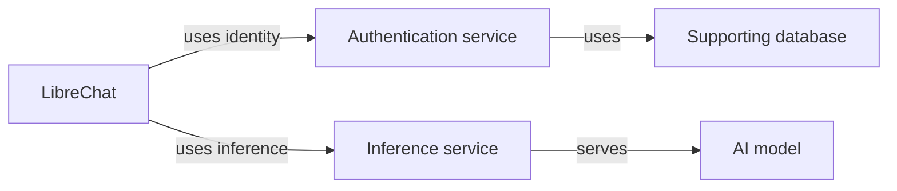

# AI Surface Model

An open model for describing the connected components, configuration and
relationships of an AI surface at varying levels of detail.

> [!TIP] What is an AI Surface?
> 
> An AI Surface can include applications, agents, models, inference services,
> authentication, tools, data stores, supporting infrastructure and the connections
> between them. Descriptions can grow from a few known components into a detailed
> representation of a complete setup. Different parts can have different depths.

**Status: early conceptual draft.** This repository contains the project scope,
draft concepts, synthetic examples and interoperability research questions.
There is no released schema, validator, exporter or deployment engine yet.

## What the AI Surface Model is for

The AI Surface Model evolved from the private [Injection8r](https://injection8r.com) project.

We looked at using other SBOM approaches (see below) but they were specific to the problem they were solving, which is different to the one we are solving.

> [!TIP] What problem is Injection8r solving?
>
> Born from solving prompt injections, the Injection8r project has evolved.
> Today, the private Injection8r project is concerned with whole-AI Surface security,
> not just LLM-oriented prompt injections -- although they are still in-scope.
> A key part of this problem is "seeing" all of the parts of what we call an AI Surface:
> the code (e.g. agent loop), including any hooks for pre/post-LLM or tool calls, then
> any MCP connections (e.g. to a domain-specific app like a CRM or HCIM or ERP), and then
> all the subsystems used for things like AAA, policy, and much more.

**THE POINT BEING THAT THE SECURITY OF AN AI SURFACE DEPENDS ON EVERYTHING BENEATH THE SURFACE NOT JUST THE CODE OR THE LLM.**

As a result of this evolution, the focus of Injection8r has now become working with AI Surface Models
in the Injection8r Labs.

### Here's what we use the AI Surface Model for

- Investigate saved Surfaces offline, including which contain a particular
  component and version, with explicit coverage limits.
- Remember equipment and integration configuration for lab and bench setups.
- Bind Experiment results to the Surface revision and effective setup tested.
- Connect provenance and history across lab, development and production services.
- Share setups that other people can recreate, with prerequisites and gaps visible.
- Run many Experiments against one Surface, or one Experiment across many Surfaces.

The model is usable independently of Injection8r or any particular Lab product.
Security investigation is one use; reproducibility, configuration understanding
and general experimentation are equally relevant.

## Progressive detail

A description can say that LibreChat uses an authentication service without
already knowing its product, version or integration settings. It can later
identify Keycloak, describe the connection, and expand Keycloak's own dependencies.
The original component keeps its identity as more information is recorded.

First- and second-degree components are supported conceptually; depth has no
fixed two-hop ceiling. Authors choose scope, and unknown or omitted information
remains visible. A partial description is useful even when it cannot yet support
full recreation.

This is a conceptual example, not a claim about a particular installation.

## Definitions and evidence

A versioned Surface definition describes composition and configuration. Separate
linked records describe deployments, dated observations, provenance and Experiment
Runs. A Run refers to the immutable definition revision and the effective setup
used. Later discovery must not silently change what an earlier result refers to.

See the [draft concepts](spec/README.md) and
[LibreChat examples](examples/README.md).

## Working with existing standards and tools

The AI Surface Model owns its domain meaning. We intend to exchange supported
subsets through CycloneDX and SPDX, using their native constructs where suitable
and reporting omitted or transformed information. Interoperability and round-trip
fidelity must be demonstrated with named versions and consuming tools.

[CycloneDX](https://cyclonedx.org/), [SPDX](https://spdx.dev/),
[Prismor](https://github.com/PrismorSec/prismor) and
[sbom-tools](https://github.com/sbom-tool/sbom-tools) are relevant prior work.
They are not dependencies of this initial repository. See the
[interoperability research](docs/interoperability.md).

## Start here

- [Draft concepts and open decisions](spec/README.md)
- [Examples at different depths](examples/README.md)
- [Basic LibreChat reference setup](examples/librechat/basic/README.md)
- [Interoperability research](docs/interoperability.md)
- [Roadmap](docs/roadmap.md)
- [Contributing](CONTRIBUTING.md)
- [Licence boundaries](LICENSING.md)

## Licence

Machine-readable model assets, schemas, examples, code snippets and tooling are
licensed under [Apache License 2.0](LICENSE). Written specification and
documentation are licensed under [Creative Commons Attribution 4.0 International](LICENSE-DOCS).

Commercial and proprietary reuse are welcome under those terms. Users retain
control of the licensing and publication of their own Surface descriptions and
Experiment data. Third-party material retains its applicable terms.

This is an independent Injectionator project, with no claimed OWASP affiliation
or endorsement. See [LICENSING.md](LICENSING.md) for the exact file scope.
