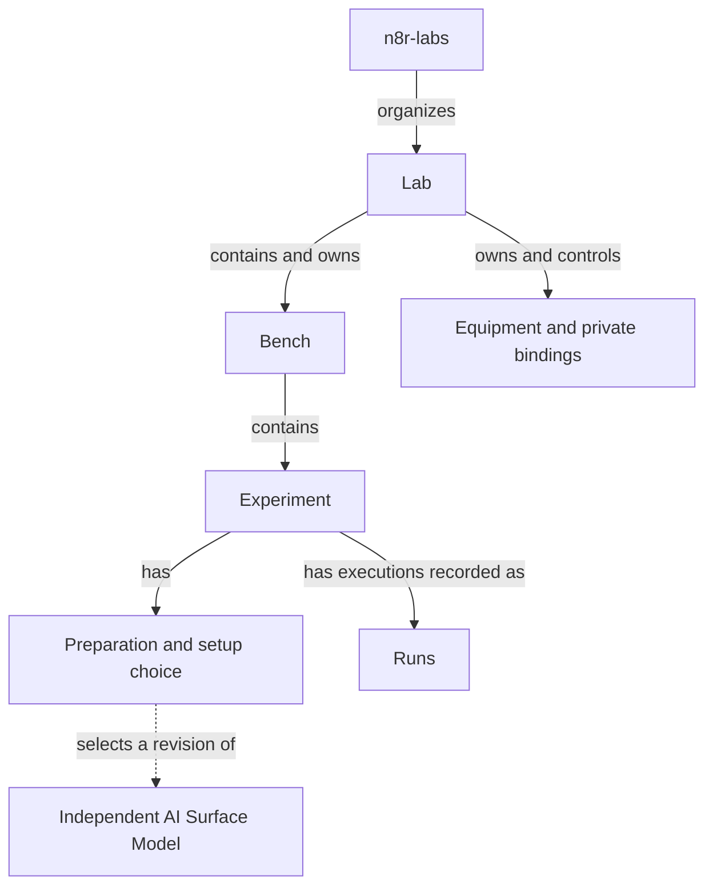
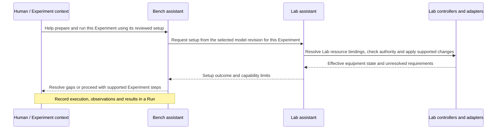

# n8r-labs structure and control flow

The ownership hierarchy is **n8r-labs → Lab → Bench → Experiment**. A Bench is
always contained and owned by its Lab. **AI Surface Models exist independently**
and are connected to Experiments during preparation by selecting a model revision.

Setup requests travel back up: the Experiment asks its Bench, and the Bench asks
the Lab to provide the required environment. The Lab binds the described components
to deployment resources and carries out supported setup work. This lets a user
think of a Surface as bound to a deployment while keeping the Lab-managed
indirection explicit.

This is a high-level companion to the [n8r-labs use case](n8r-labs-use-case.md).
It describes the intended responsibilities and relationships, not a storage schema
or a claim that the full workflow is implemented. Labs, Benches and their
assistants are specific to this consumer; the independent AI Surface Model can
be used without them.

The [illustrative JSON example](../examples/relationships/README.md) shows two
Labs using the same independent model revision through separate preparations and
resource bindings. It expresses these relationships without specifying application
internals. Today's workflow is for development; production use is a design goal.

## Ownership and working context

The preparation records what an Experiment wants to use. Selecting a model does
not make the model part of the ownership hierarchy. The model describes the
Surface, while the Experiment supplies its purpose and procedure and Runs record
its results.

| Record or context | What it represents | Principal relationships |
| --- | --- | --- |
| n8r-labs | The application in which people organize Labs and their work. | Provides access to Labs. |
| Lab | An equipment environment and the authority to operate it. | Provides context for Benches; owns equipment, private bindings and current Bench assignments or reservations. |
| Bench | A working context for preparing and running Experiments. | Is contained and owned by one Lab; holds Experiments; uses its Bench assistant to request help from the Lab assistant. |
| Experiment | The work to perform: its purpose, procedure and desired setup. | Belongs to a Bench; owns its setup; can have multiple Runs. |
| Desired setup | The environment requested for a particular Experiment preparation. | Selects an independent model revision; the Lab resolves resource bindings and supported configuration. |
| AI Surface Model | An independent description of the AI system: components, connections, settings and known gaps. | Can exist without a Lab, Bench or Experiment; multiple Experiments can select it, and Lab-managed bindings connect it to deployments. |
| Run | One execution of an Experiment. | Links the Experiment, the definition revision and the effective setup to observations and results. |

These relationships need not be stored as one nested object. Identity and explicit
references allow a setup to be reused and evidence to remain attached to the
revision it describes. The hierarchy also does not impose a one-to-one mapping
between Experiments and Surfaces: several Experiments can use one Surface
revision, and one Experiment can have Runs against several Surfaces or revisions.

## Setup requests travel back up

The Experiment determines what it needs to do. The Bench assistant helps arrange
and carry out that work. When it needs equipment changes, it requests them from
the Lab assistant. The Lab retains authority over its resources and decides which
effects are permitted through its controllers and adapters.

Here, “the Experiment asks” means a human or an authorized workflow acting in
that Experiment's context. It does not imply that an Experiment record or a
configuration file executes itself.

The Lab does not choose a Bench's setup, and the Bench does not choose an
Experiment's purpose or procedure. Requests originate with the Experiment and
move toward the Lab's resources. Readback and results return to the requesting
context. The Bench assistant coordinates the Experiment; the Lab assistant
coordinates equipment work.

A Bench can prepare an Experiment offline. Equipment effects require it to be
live on its Lab, with the current assignment or reservation. A request can remain
partly unsupported; the assistant must preserve those gaps rather than treat a
saved model as proof that the environment is ready. The use case explains the
[equipment checks and capability limits](n8r-labs-use-case.md#from-desired-setup-to-equipment-effects).

## The AI Surface Model is configuration data

In this workflow, the model is “just” a configuration file: data that people and
tools read to understand the desired AI Surface. It can describe applications,
agents, inference services, tools, data stores and their integration settings.
It has no assistant role and grants no authority to change equipment. Consumers
interpret the supported parts and perform any authorized actions.

Inside that file, the Surface is a graph. Components have identities;
relationships link them and can carry integration configuration. Components can
be shared, connections can form cycles, and detail can extend to arbitrary depth.
That graph is separate from the Lab–Bench–Experiment hierarchy above.

A partial model remains useful. Unknown, omitted, redacted, absent and
out-of-scope information have different meanings; missing detail does not establish
absence. The [draft concepts](../spec/README.md) define these distinctions, and
the [synthetic examples](../examples/README.md) show descriptions growing in depth
while preserving component identity. Their field names remain provisional.

The portable description can state resource and credential requirements. The Lab
supplies separate bindings to actual resources and secrets. Those bindings connect
the selected model revision to a deployment for the Experiment; the model itself
does not bind to resources. A complete setup may also need software artifacts,
deployment instructions and initial data. The
current n8r-labs path supports only a bounded equipment-settings subset; it does
not translate arbitrary model content into a running environment. See the use
case's [implementation limits](n8r-labs-use-case.md#current-capability-and-remaining-work).

## A Run records what happened

The Experiment's desired setup, the Lab's resource bindings and the Run's evidence
answer different questions: what was requested, which resources were used, and
what actually happened. A Run preserves the selected definition revision and
digest alongside the effective setup and dated observations. Later model edits
must not change what earlier results refer to.

A declared connection in the model, a reachable connection observed during setup,
and a connection exercised during a Run are distinct claims. Evidence retains
its source, time, applicability and limits. Reusing a model in another Lab carries
the desired description; that Lab supplies its own bindings and collects fresh
evidence, as in the [Ken and Jacqui scenario](n8r-labs-use-case.md#ken-and-jacqui-a-synthetic-example).

Related: [project overview](../README.md), [n8r-labs use case](n8r-labs-use-case.md),
[draft concepts](../spec/README.md), [licence boundaries](../LICENSING.md).
