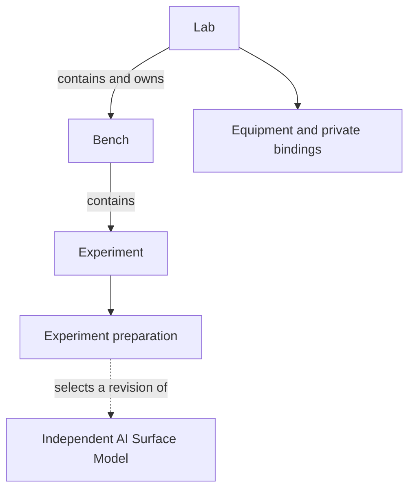
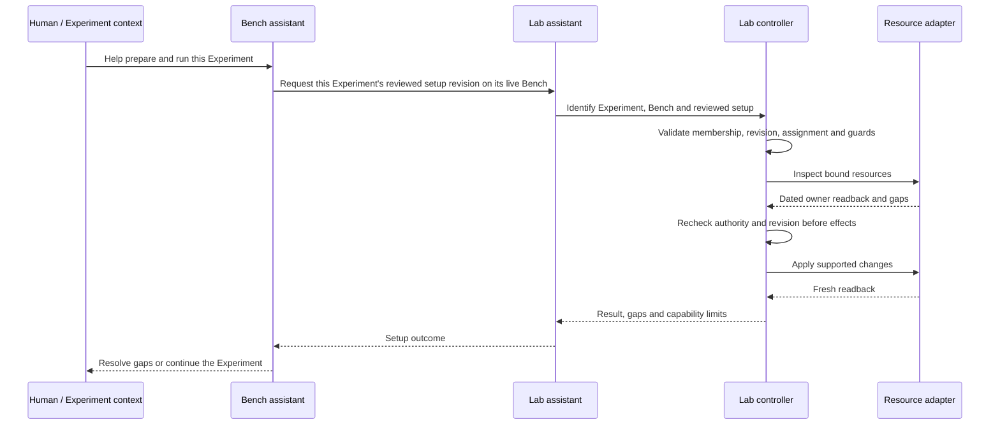

# How n8r-labs uses AI Surface Models

n8r-labs uses an [AI Surface Model](../README.md) to describe the environment an
Experiment wants its Lab to provide.

For a high-level view of the data structures and the direction of setup requests,
see [n8r-labs structure and control flow](n8r-labs-structure.md).

The model exists independently of any Lab, Bench or Experiment. It can be
inspected offline, developed gradually and selected when an Experiment is
prepared. Several Experiments can select the same revision. A saved description
does not establish that equipment has been configured or that an Experiment has
succeeded.

This document describes one consumer's ownership and execution rules. **Labs,
Benches, reservations and Lab assistants are n8r-labs concepts, not requirements
for every AI Surface Model consumer.** The independent model remains an early
conceptual draft with provisional serialization and no released conformance
schema. See the [draft concepts](../spec/README.md).

## Ownership

The n8r-labs relationship is:



The Experiment owns its setup choice, not the independent model it selects. The
Bench provides its working context. The Lab owns the equipment, resource bindings
and authority to operate them. Models can be authored and shared before any
Experiment selects them.

For the user, the Surface is bound to a deployment through its Lab. The explicit
connection is **model revision → Experiment preparation → Lab-managed binding →
deployment resources**. The Experiment requests setup through its Bench; the Lab
resolves the resources. The [illustrative relationship example](../examples/relationships/README.md)
shows the same model revision connected to different deployments in two Labs.

An Experiment can prepare its setup while its Bench is offline. Equipment changes
require the Bench to be **live on the Lab**: it must hold that Lab's current
assignment or reservation. Opening the Bench page, selecting a Surface or seeing
healthy containers does not establish that authority.

## From desired setup to equipment effects

The human can ask the Bench assistant to prepare the Experiment's setup. The Bench
delegates equipment work to the Lab assistant. The assistant interprets the request
and coordinates supported tools; deterministic controllers decide whether each
requested effect is permitted.



The intended flow can use available equipment or add missing resources when an
appropriate controller and adapter exist. A model's request does not create a
missing capability. Unsupported requirements remain visible for the human to
resolve; they must not be reported as applied.

| Responsibility | n8r-labs owner |
| --- | --- |
| Desired components, configuration and connections | Selected AI Surface Model revision |
| Model selection and Experiment-specific setup requirements | Experiment preparation |
| Working context and request origin | Bench |
| Helping prepare and run the Experiment | Bench assistant |
| Interpreting equipment requests and coordinating Lab tools | Lab assistant |
| Membership, reservation, revision and operation checks | Deterministic Lab controller |
| Resource-specific inspection, configuration and readback | Resource adapter |
| Private connection details and credentials | Lab-local bindings, outside the portable definition |
| Actual execution, effective state and results | Run records and observations |

These controls establish application-level authority within the local Lab. They
are not a claim of a general multi-user security or tenancy system.

## Definitions, bindings and evidence stay separate

An Experiment's preparation identifies the model revision selected for its
desired setup. The Lab separately determines how the described components map to
available resources. Neither the selection nor the binding establishes what was
actually configured or exercised; those claims need dated observations and Run
evidence.

Models can be revised independently. A later revision must not silently change
an earlier preparation or the definition that a recorded result refers to.
Preserving the selected content with a Run supports that attribution without
making the independent model a child of the Experiment.

A consumer may support only part of a model's requirements. Its setup result
must identify the subset handled and the remaining gaps. A successful operation
on one component does not establish that the whole Surface has been recreated.

A live Run preserves the desired setup, model bytes and revision alongside
readback of its bound equipment. It rechecks relevant setup and binding state
before target effects. Practice Runs preserve desired setup and resource/step
observations separately. Later edits must not rewrite historical evidence.

Portable Experiment packages carry desired content, not source Lab reservations,
credentials or successful Run claims. Recipients must review the content, supply
local bindings and collect their own evidence. A partial model may support useful
inspection while lacking enough detail for recreation.

## Ken and Jacqui: a synthetic example

All names, identifiers and configuration below are illustrative. They describe no
real deployment and include no private infrastructure or credentials.

Ken prepares an Experiment called “First answer” on his Bench. He selects an
independent partial description of LibreChat connected to an inference service.
For example, this provisional model fragment records one known relationship and
two unknowns:

```json
{
  "surface": {"id": "example-chat", "name": "Research chat"},
  "components": [
    {"id": "chat", "kind": "application", "name": "LibreChat", "version": null},
    {"id": "inference", "kind": "inference-service", "name": "Example inference"}
  ],
  "relationships": [
    {"id": "chat-inference", "from": "chat", "to": "inference", "kind": "uses"}
  ],
  "coverage": {"unknown": ["deployed image digest", "database initialization"]}
}
```

This fragment is illustrative data, not a deployable specification or schema
conformance example. Ken's Lab keeps its actual resource addresses and credentials
in local bindings. When Ken's Bench is live, the assistant can request supported
setup operations for the explicitly named Experiment revision.

Jacqui selects the same model revision for her own Experiment under her own Bench
and Lab. She can inspect it or derive a revised description without taking Ken's
reservation or changing his Experiment. Her Lab needs its own resource bindings.
Reusing a host or an authorized account would not by itself establish separate
storage, equivalent configuration or successful recreation.

The intended complete rehearsal creates a separately running LibreChat for Jacqui,
resolves the missing image, configuration, data and Agent initialization details,
then performs a fresh prompt Experiment. Her Run must establish what actually ran
and what answer was observed. Ken's previous evidence is useful background, not
proof that Jacqui's environment works.

## Current capability and remaining work

**Today this workflow is for development.** The model is being designed for use
with production systems too, but production support is a future direction, not
a capability or readiness claim established here.

The current consumer supports preparing Experiments with selected model content,
limited equipment operations and preserving setup information with Runs. This
model repository describes the relationships; it does not ship those consumer
capabilities as a deployment engine.

Equipment support remains narrow. Arbitrary configuration, missing-resource
provisioning and whole-model equivalence are not established by the current path.

The complete Ken-to-Jacqui deployment rehearsal remains planned. Model-schema
conformance, general model-to-adapter translation, encrypted sharing and universal
recreation guarantees are not claimed. The model's wider interoperability work
has its own [roadmap](roadmap.md) and [mapping questions](interoperability.md).

Related: [project overview](../README.md), [draft concepts](../spec/README.md),
[synthetic examples](../examples/README.md), [licence boundaries](../LICENSING.md).
