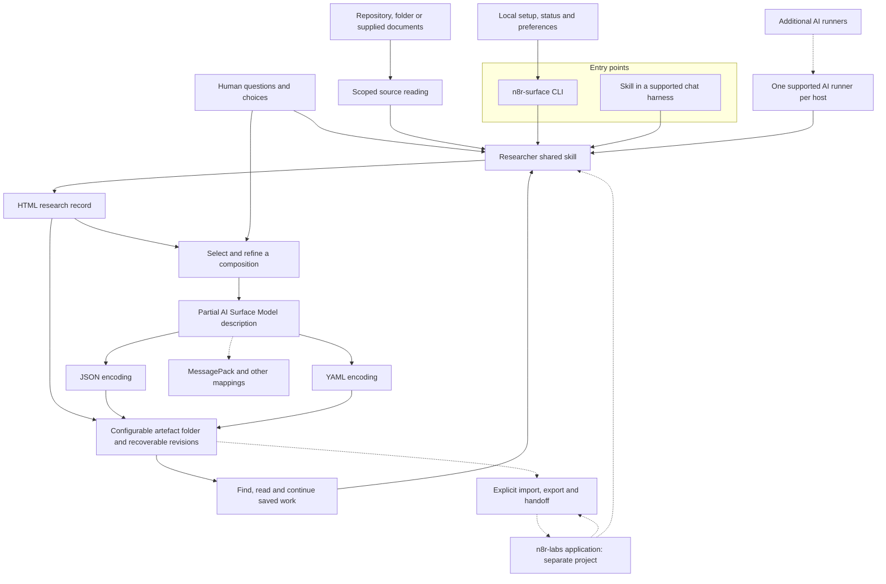

# n8r-surface capability map

`n8r-surface` is the proposed standalone tool for researching software and
authoring partial AI Surface Model descriptions with a human. Researcher is its
shared discovery skill. The tool can run independently and later exchange work
with n8r-labs.

Build and demonstrate the standalone Researcher here first, then integrate that
same core into n8r-labs. Consider Lab requirements while defining the shared
contracts; application implementation is not a prerequisite for standalone work.

**Status, 4 November 2026:** design and delivery issues only. No Researcher skill,
CLI, research-record format or tool-specific model codec is implemented here yet.
This map describes intended capabilities, not a released product.

- [Next work and critical path](critical-path.md)
- [Design requirements and open choices](design.md)
- [Tracking issue #13](https://github.com/injectionator/ai-surface-model/issues/13)
- [Map and planning issue #14](https://github.com/injectionator/ai-surface-model/issues/14)

## Capability map

Solid arrows show the first standalone workflow. Dashed arrows show later
capabilities or integration with the application project.

The AI runner and the destination for results are independent choices. A user
can research locally with their chosen supported AI, save files and later send
selected work to a Lab. A Lab connection is optional for standalone authoring.

## Delivery boundaries

| Capability | Delivery position | Evidence required |
| --- | --- | --- |
| HTML research record and partial graph contract | Next: [#15](https://github.com/injectionator/ai-surface-model/issues/15) | Synthetic examples have explicit sources, decisions, gaps and stable references. |
| JSON and YAML representations | Contract in #15; usable output in #17 | Supported meanings survive conversion, including relationship attributes and unknowns. |
| TypeScript CLI with npm/npx distribution | Agreed; implement in #16 | Installed package and bundled assets work on supported Node.js versions without the source checkout or Bun. |
| Startup, source access and safe artefact tools | Then: [#16](https://github.com/injectionator/ai-surface-model/issues/16) | Setup, path handling, conflict detection and recovery work in temporary folders. |
| Researcher conversation, shared skill and one CLI runner | Then: [#17](https://github.com/injectionator/ai-surface-model/issues/17) | Real discovery, human correction, save/resume and model output work without a Lab. |
| ChatGPT with supplied documents | First external skill host, in #17 | The same core skill produces usable records and descriptions in the actual host. |
| More AI runners and external harnesses | Later | Each adapter has demonstrated authentication, tool use and continuation. |
| Standalone executables | Later distribution option | Each supported platform runs the packaged tool and required assets without a separate Node.js installation. |
| MessagePack and additional encodings | Later, when a consumer needs them | A bounded mapping preserves meanings or reports unsupported information. |
| Researcher in n8r-labs and artefact exchange | Application stage after the standalone milestone | The application uses the versioned core and passes shared import/continuation cases. |
| Optional remote Researcher execution | Later integration | Source access, authentication and session scope are demonstrated against a named endpoint version. |
| Rich editing, automatic synchronisation and advanced corpus search | Outside the first path | A concrete use case justifies extending the simple folder workflow. |

## Repository ownership

This repository owns the standalone CLI, portable Researcher skill, artefact
contracts, model encodings and consumer-side integration. The AI Surface Model
remains the one model; the CLI name does not rename it.

The n8r-labs project owns its application assistant, attachment UI, source access,
Lab sessions, storage, permissions and API/MCP endpoints. This repository
maintains the versioned Researcher core, artefact contracts and shared examples.
The application later consumes an identified revision through its own adapters;
it does not need to host the CLI or adopt its local folder layout.

Keep the [compatibility contract](design.md#compatibility-contract) current as
the tool develops. Review Lab requirements during #15 and carry the same
acceptance examples into application integration. Compatibility remains a goal
until a named application version passes those cases. Do not copy private
application prompts or operational records here.

## Keeping the map useful

Issue #13 is the overview, this page is the capability map, and
[critical-path.md](critical-path.md) names the next delivery gate. Detailed
requirements live in [design.md](design.md); implementation issues carry their
own acceptance checks.

Update these documents in the PR that changes a capability or delivery decision.
Record implemented behaviour only with its verification evidence. Keep later
ideas on this map until they are ready to become bounded issues. A draft PR,
passing fixture checks and a working live integration are distinct states.

Related: [model overview](../../README.md), [draft concepts](../../spec/README.md),
[model roadmap](../roadmap.md), [interoperability](../interoperability.md).
