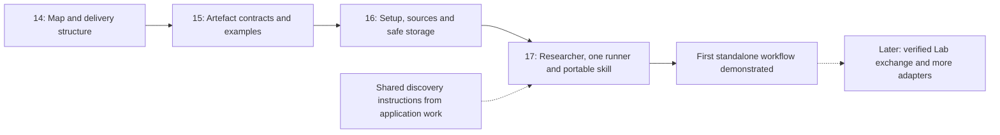

# n8r-surface critical path

The first usable outcome is a standalone Researcher that reads supplied repo/docs,
works with a human, saves an HTML research record and produces a partial AI
Surface Model description in JSON or YAML. The user can find the files, edit them
and resume safely. No running target or Lab is required.

**Current work:** [#14](https://github.com/injectionator/ai-surface-model/issues/14)
establishes this map and delivery structure. **Next implementation issue:**
[#15](https://github.com/injectionator/ai-surface-model/issues/15). Later issues
remain queued until their inputs are available. This is an ordered delivery path,
not a release schedule or a declaration that implementation has started.

## 1. Define artefacts with concrete examples

**Issue:** [#15](https://github.com/injectionator/ai-surface-model/issues/15).

Define a versioned experimental HTML research record and partial Surface graph.
Use synthetic sources for two unrelated products and show how selected findings
compose into one description. Establish which representation owns each fact in
the HTML, how manual edits are retained, and what a revision identifies.

Specify JSON/YAML preservation rules and examples with attributed nodes and
relationships, shared components, cycles, multiple connections, unknowns and
conflicting evidence. Select the smallest suitable runtime and first AI runner;
the map does not choose them implicitly.

**Advance when:** the examples and checks give #16 and #17 concrete contracts,
including a clear shared-skill handoff requirement. Do not relabel existing
illustrative fixtures as schema-conforming without specifying and checking them.

## 2. Build the local foundation

**Issue:** [#16](https://github.com/injectionator/ai-surface-model/issues/16).
**Depends on:** #15.

Implement startup/status, missing-setup guidance, current-directory and explicit
source selection, and the configured artefact folder. Provide bounded tools to
list, read, create and revise records. Updates check the version read earlier,
retain a recoverable previous revision and complete atomically.

Proposed defaults are `~/.n8r/n8r-surface.json` for settings and
`~/n8r/artefacts` for the corpus. Show effective settings and allow overrides.
Keep AI selection separate from an optional Lab destination. Preserve invalid
configuration for repair; non-interactive commands must not wait on a prompt.

**Advance when:** synthetic tests cover first run, missing/unwritable paths,
unavailable runners, interrupted saves and human edits between read and write.
The executable is a local foundation at this point; it must not present an
unconnected discovery command as working research.

## 3. Demonstrate the Researcher workflow

**Issue:** [#17](https://github.com/injectionator/ai-surface-model/issues/17).
**Depends on:** #15, #16 and an identified shared-instruction revision.

Connect one supported AI runner to the shared Researcher skill and local tools.
Support a human question, source inspection, saved findings, consequential
follow-up questions, corrections, continuation and JSON/YAML model output.
Package the same core skill for ChatGPT with supplied documents, the first
external host. Host adapters provide access; they do not maintain separate
versions of discovery knowledge.

**Advance when:** a real supported-runner session completes the workflow on
permitted examples, the records survive save/reopen, and a second product works
without product-specific code. Compare facts, selections and gaps across the
CLI and external skill; generated wording need not match. Record any host
limitation and do not claim untested compatibility.

This completes the first standalone milestone. It does not establish that a Lab
importer accepts the output; that needs a separate named-consumer trial.

## Work after the first milestone

The [capability map](README.md) retains optional Lab exchange, remote Researcher
execution, additional AI runners and MessagePack. Create their delivery issues
when their consumer contracts and acceptance cases are concrete.

Keep browser editing, a general database, automatic two-way synchronisation,
advanced indexing and deployment automation outside this first path. Users can
choose their own editor; safe Researcher-assisted updates are sufficient here.

## Review and evidence

Each issue uses its own branch and draft PR in this repository. Link the primary
issue with `Closes #N` and the overview with `Related to #13`. Keep draft status
until review readiness is authorised; merging and releasing are separate steps.

Run the relevant [repository checks](../../CONTRIBUTING.md)
and the issue's acceptance cases. Distinguish file syntax, reference integrity,
model behaviour and actual consumer compatibility. Update the map and this path
when scope or dependencies change so the next task remains explicit.
