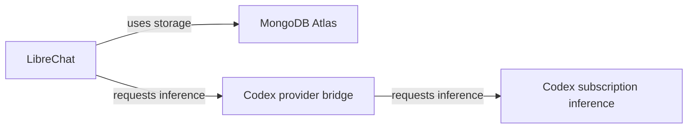

# Basic LibreChat reference Surface

This is a sanitized, illustrative description of a minimal composition: LibreChat,
MongoDB Atlas and inference through a Codex provider bridge using subscription
access. It is intended for developing a model and its consumers together.
It is not an export of a real installation or evidence of a successful recreation.

Only configured parts are component nodes. RAG and MCP are not configured in this
example and have no nodes or connections. That scoped declaration does not make
missing information elsewhere an assertion of absence. The application's own
authentication and other unexpanded internals remain part of its unknown detail.

The bridge is part of this composition, not a claim that LibreChat has a built-in
subscription integration. A Lab assistant's inference connection is separate.
The subscription service is represented without inventing an underlying model
identity. Each recipient must establish their own access and selected model.

## Files and use

- [surface.json](surface.json): the portable component graph and requirements.
- [bindings.example.json](bindings.example.json): synthetic local mapping example,
  separate from the definition; it is not a deployment configuration.
- [recreation.md](recreation.md): what a recipient needs and what to verify.
- [Draft exchange contract](../../../spec/native-draft.md): the provisional shape
  used by this example and experimental consumers.

A consumer can read and inspect `surface.json`, retain its identities and exact
source bytes, and map its components to local equipment. It must report unsupported
meanings or missing requirements instead of silently dropping them. Loading this
file does not configure equipment. Keep local bindings, secret values, observations
and Experiment Runs outside the portable definition.

Settings are descriptive concepts, not executable LibreChat or provider keys.
The provider artifact, pinned builds and complete configuration are not supplied;
this package currently supports inspection and binding, not automatic recreation.
The `basic-1` revision is an example label. No canonical digest algorithm or
released model version is established by it.

The JSON files use [Apache-2.0](../../../LICENSE); prose uses
[CC-BY-4.0](../../../LICENSE-DOCS). See [licensing](../../../LICENSING.md).
