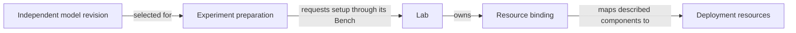

# Labs, Experiments and independent Surface Models

The [JSON example](labs-and-models.json) illustrates ownership, model selection
and resource binding. Its field names are invented for explanation. It is not
an n8r-labs file format, API, storage layout or deployment recipe. All identities
and deployments are synthetic; no equipment was inspected or configured.

## Ownership and association

A Lab contains and owns its Benches. Each Bench contains its Experiments. An
AI Surface Model exists independently: it can be created, inspected, revised and
shared before any Experiment selects it. The hierarchy ends at the Experiment.

Preparing an Experiment connects it to a selected model revision. That association
does not transfer ownership of the model to the Experiment, Bench or Lab. Several
Experiments can select the same revision, and a model can remain unselected.

The separate `surfaceModels` collection expresses this independence only; it
does not specify where models are stored. Revision labels illustrate stable
references, not a standardized revision format.

## How a Surface is bound to a deployment

The user-facing relationship is **“this AI Surface is bound to this deployment
through the Lab.”** The model describes the desired components and relationships.
The Lab supplies the binding from those components to deployment resources.

The request flows **Experiment → Bench → Lab**. The Lab resolves available
resources and carries out supported setup work. A model is descriptive data;
selecting it neither creates a resource binding nor applies configuration by
itself. Lab-managed bindings make the indirect deployment relationship explicit.

The JSON shows the resulting illustrative associations:

| Relationship | Example |
| --- | --- |
| Containment | `lab-a` owns `bench-a`, which contains `experiment-a`. |
| Selection during preparation | `preparation-a` connects `experiment-a` to `model-chat-r1`. |
| Lab-managed binding | `binding-a`, under `lab-a`, maps the selected model's `component-chat` to `resource-a`. |
| Independent reuse | `experiment-b` selects the same revision; its own Lab maps the component to `resource-b`. |
| Model without an Experiment | `model-unselected` has no preparation or deployment association in this example. |

The model contains no deployment resource references. The Labs' mappings refer
to it, rather than embedding Lab-specific addresses or credentials in it. Reuse
of a model does not imply shared resources, equivalent effective configuration
or the same results.

## Evidence and scope

These bindings illustrate intended associations, not proof that either deployment
is ready or that an Experiment has run. A Run needs to retain the model revision,
Lab binding and effective setup used, together with its own observations and
results. Later preparation choices must not rewrite that evidence.

Only one logical component per model is shown. Supporting components, connections
and configuration are explicitly omitted, not asserted absent. This is not enough
information to recreate a complete Surface.

Today's n8r-labs workflow is for development. Production use is a design goal;
these examples do not establish current production support or readiness.

The JSON uses [Apache-2.0](../../LICENSE); this explanation uses
[CC-BY-4.0](../../LICENSE-DOCS). See the [licence boundaries](../../LICENSING.md).

Related: [structure and control flow](../../docs/n8r-labs-structure.md),
[n8r-labs use case](../../docs/n8r-labs-use-case.md),
[draft concepts](../../spec/README.md), [all examples](../README.md).
