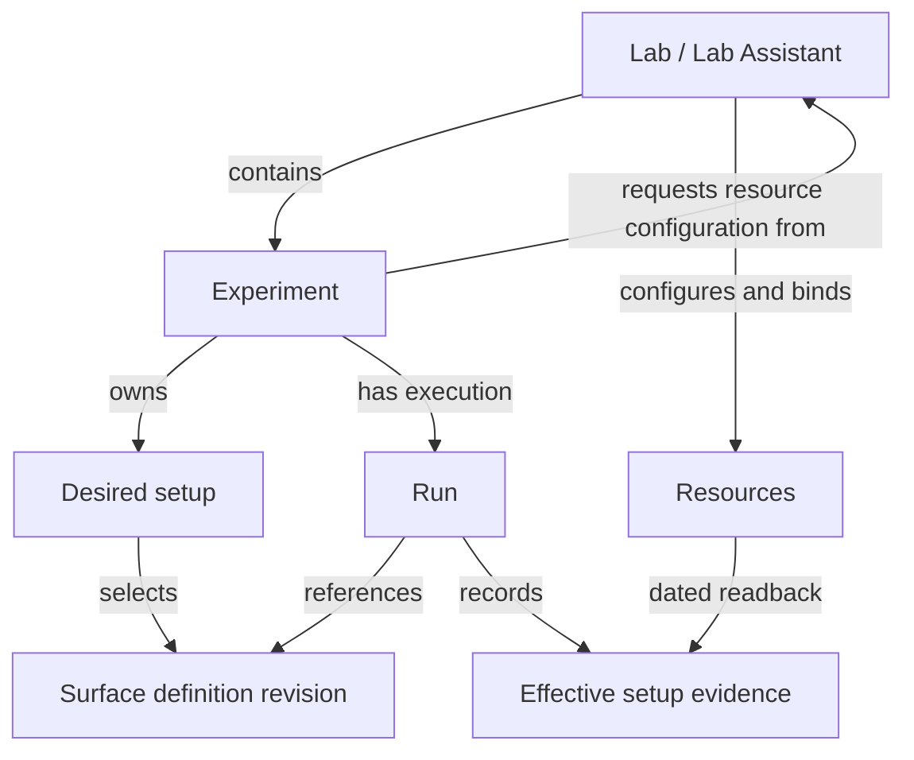

# The AI Surface Model and its fragments

There is one model: the **AI Surface Model**. **Lab**, **Experiment** and related
descriptions are fragments within it: focused parts of a system or its context,
connected through identities and references. Fragment is working terminology;
boundaries and serialization remain open.

A **Lab contains Experiments**. Each **Experiment owns its desired setup** and
asks the Lab directly to configure the resources it needs. The Lab owns resource
configuration and local bindings. A **Run** records one execution and its actual
setup, outcomes and evidence.

These pages follow the [draft specification](../spec/README.md). They describe
intended responsibilities; this repository provides no deployment engine.

## The main questions

| Concept | Question it helps answer | Read more |
| --- | --- | --- |
| Lab | Who owns resources, local bindings and configuration authority? | [Lab](lab.md) |
| Experiment | What do we want to learn, how, and using which desired setup? | [Experiment](experiment.md) |
| Surface definition | Which components, configuration and relationships describe the system at this revision? | [Definitions and evidence](ai-surface-model.md#definitions-and-evidence) |
| Run | What happened on this occasion, using which setup? | [Experiments and Runs](experiment.md#experiments-and-runs) |

An **AI Surface** is the connected system being described. An AI model, such as a
language model, can be one component in that system. The AI Surface Model supplies
the vocabulary for its description and context; it is not the language model.

## Connections at a glance

Lab and Lab Assistant share one entity. Setup intent, Lab authority and observed
results remain distinct. A saved definition does not allocate resources, apply
configuration or establish readiness. Historical records retain their original
identities and meanings when terminology changes.

A Surface description is useful independently of any Lab product. One Experiment
can have Runs against several Surfaces, and several Experiments can use the same
Surface revision. Shared components retain their identities across those uses.

A deployment binding maps a definition to actual resources. Dated observations
record the effective setup; a Run links that evidence to the exact definition
revision used. Later discoveries do not rewrite earlier results.

## Follow one investigation

Imagine a Lab investigating sign-in behavior in an AI application. This is a
synthetic scenario, not a deployed or tested system.

1. The **Experiment** asks whether an authentication setting changes which
   synthetic accounts can sign in. It specifies the procedure, evidence and
   desired setup, and asks its Lab to prepare it.
2. The **Lab** configures the application, authentication service and observation
   tools through supported operations. Unmet requirements remain visible.
3. An **AI Surface description** identifies the application and identity service,
   their connection, settings and gaps.
4. Each **Run** records what was actually used and observed. Comparing Runs
   requires checking which settings, data and other conditions differed.

The [LibreChat examples](../examples/README.md) illustrate the description step
at two depths. They contain no Lab or Run records and no test results.

## Choose your next level of detail

Start with the [AI Surface Model overview](ai-surface-model.md), then explore
[Lab](lab.md) and [Experiment](experiment.md).

| If you are wondering… | Start here |
| --- | --- |
| Do I need every part to describe one system? | [Using a Surface independently](ai-surface-model.md#do-i-need-a-lab-or-an-experiment) |
| Who configures an Experiment's resources? | [Requesting a setup](experiment.md#requesting-a-setup) |
| What belongs in an Experiment versus a Run? | [Experiments and Runs](experiment.md#experiments-and-runs) |
| Can I begin with incomplete information? | [Detail and uncertainty](ai-surface-model.md#detail-and-uncertainty) |
| How do old results stay meaningful? | [Changes between Runs](experiment.md#changes-between-runs) |
| Can another user recreate the setup? | [Recreation requirements](experiment.md#can-someone-else-recreate-the-setup) |

For precise meanings, see the [draft concepts](../spec/README.md). For possible
exchange formats, see [interoperability](../docs/interoperability.md). The
[roadmap](../docs/roadmap.md) identifies work still to be designed and demonstrated.
