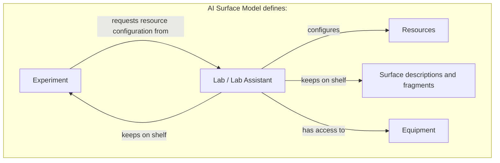

# The AI Surface Model and its fragments

There is one model: the **AI Surface Model**.

**Lab**, **Experiment**
and related descriptions are **fragments** within it. A fragment describes a
focused part of the system or its context and connects to other fragments
through identities and references.

A **Lab has equipment and a shelf of reusable Surface descriptions and
Experiments**. Each Experiment describes a question, method and required setup,
and requests resource configuration directly from the Lab. A Run records one
execution using the setup actually provided. A Lab can persist across many
investigations; its shelf can hold descriptions that have never been deployed.

These pages are a conceptual guide. Fragment is our working term, with no fixed
file format or packaging unit. Boundaries and representation remain open.
The concepts follow the
[draft specification](../spec/README.md). There is no released schema or execution
engine for the model.

## The main questions

| Concept | Question it helps answer | Read more |
| --- | --- | --- |
| Lab | What equipment, reusable descriptions and ongoing work are available, and who prepares the requested setup? | [Lab](lab.md) |
| Experiment | What do we want to learn, and how will we investigate it? | [Experiment](experiment.md) |
| Surface definition | Which components, configuration and relationships describe the system at this revision? | [Definitions and evidence](ai-surface-model.md#definitions-and-evidence) |
| Run | What happened on this occasion, using which setup? | [Experiments and Runs](experiment.md#experiments-and-runs) |
| Lab context | What must be retained or retrieved to resume work across sessions? | [Context and memory](lab-context.md) |

An **AI Surface** is the connected system being described. The **AI Surface Model**
provides the vocabulary for all these descriptions. An AI model, such as a language
model, can be one component within a Surface; that is a different use of the word
model. Read the [model overview](ai-surface-model.md) for the broader scope.

## Connections at a glance

The box represents the single model. Read the setup path from top to bottom:
the Experiment requests resource configuration from the Lab, and the Lab
configures the resources. The other arrows describe equipment access and the
Lab's shelf. Shelf membership does not allocate equipment or activate a setup.

Lab and Lab Assistant share one node. The assistant name identifies the same
Lab acting on setup requests and maintaining the context of its work.

The request describes the intended setup. Deployment bindings and dated
observations record what was actually configured and available. The model
describes these responsibilities; this repository does not implement request
execution.

A Surface description is useful on its own, including for offline investigation.
A Lab product is optional. One Experiment can have Runs against several
Surfaces, and several Experiments can have Runs against the same Surface
revision. Independently authored fragments can later be composed into a broader
description with explicit relationships and revision references.

The initial execution policy permits one active setup in a Lab, with multiple
components as needed. The shelf can hold many potential Surfaces and
Experiments. Concurrent active setups are deferred; the model has no permanent
one-Surface-per-Lab restriction. Scheduling and resource allocation are not
implemented here.

The definition describes a particular composition and configuration. A separate
deployment binding maps it to concrete resources. Dated observations describe
what was actually present or observed. The Run links the relevant revision,
deployment and effective setup so that its results retain their context.
Each record retains its own role, history and references.

## Follow one investigation

Imagine a Lab investigating sign-in behavior in an AI application. This is a
synthetic scenario, not a report of a deployed or tested system.

1. The **Experiment** asks whether changing an authentication setting changes
   which test accounts can sign in. It specifies the procedure, what to record
   and the working setup needed, requesting resource configuration from the Lab.
2. The **Lab** keeps the Experiment and relevant descriptions on its shelf. It
   prepares the application, authentication service, synthetic test accounts
   and observation tools by attaching existing resources or deploying new ones;
   any unmet requirements remain visible.
3. An **AI Surface description** identifies the application and authentication
   service, their connection, known settings and gaps in the description.
4. Each **Run** records the setup actually used and the outcomes. Comparing Runs
   requires checking which settings, data and other conditions differed.
5. **Lab context** retains decisions and evidence, with a source-linked summary
   to resume the investigation in another session.

The [LibreChat examples](../examples/README.md) illustrate the description step
at two depths. They contain no Lab or Run records and no test results.

## Choose your next level of detail

Start with the [AI Surface Model overview](ai-surface-model.md), then explore
the [Lab](lab.md) and [Experiment](experiment.md) pages.
Each page starts with its purpose, then covers an example, further detail and
common questions.

For specific questions:

| If you are wondering… | Start here |
| --- | --- |
| Do I need every part to describe one system? | [Using a Surface independently](ai-surface-model.md#do-i-need-a-lab-or-an-experiment) |
| Who configures the resources an Experiment needs? | [Preparing a setup](lab.md#requesting-and-preparing-a-setup) |
| How do saved descriptions differ from running systems? | [Equipment, shelf and active setup](lab.md#equipment-shelf-and-active-setup) |
| What belongs in an Experiment, and what belongs in a Run? | [Experiments and Runs](experiment.md#experiments-and-runs) |
| Can I begin with incomplete information? | [Detail and uncertainty](ai-surface-model.md#detail-and-uncertainty) |
| How do old results stay meaningful when a setup changes? | [Changes between Runs](experiment.md#changes-between-runs) |
| Can someone recreate the setup from its description? | [Recreation requirements](lab.md#can-someone-else-recreate-a-setup) |
| How can a Lab resume work after a session ends? | [Lab context and memory](lab-context.md) |

For precise semantics, continue to the [draft concepts](../spec/README.md).
For possible exchange formats, see [interoperability](../docs/interoperability.md).
The [roadmap](../docs/roadmap.md) explains what still needs to be designed and
demonstrated.
