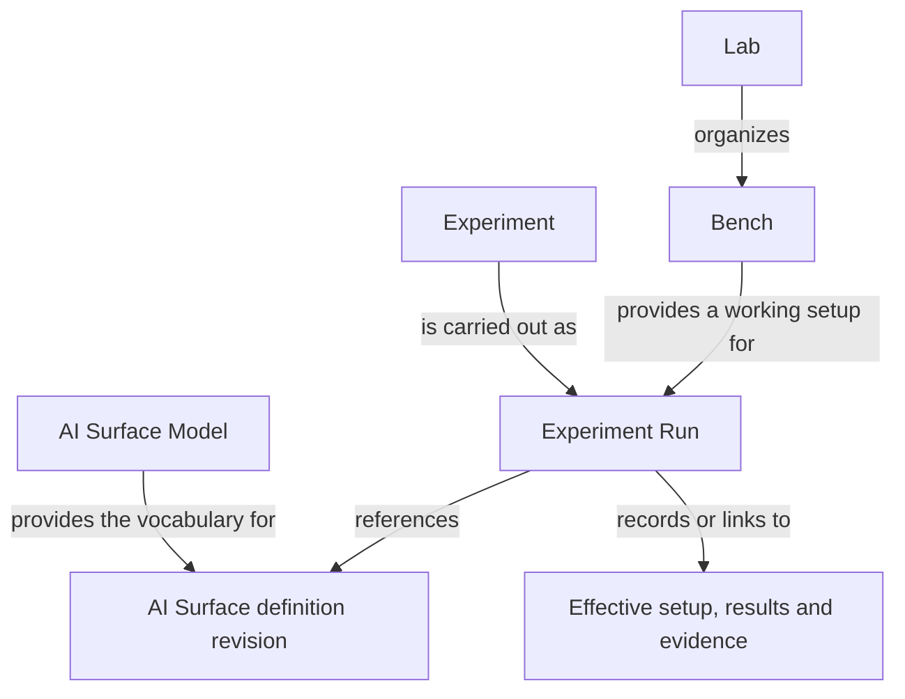

# How the models fit together

A **Lab** organizes ongoing work. A **Bench** brings together a working setup for
that work. An **Experiment** describes a question and how to investigate it. The
**AI Surface Model** describes the AI system involved, its connections and what
is known about it. A **Run** records one execution of an Experiment.

These pages are a conceptual guide. Lab and Bench are proposed working vocabulary;
their boundaries and representation remain open. The Surface concepts follow the
[draft specification](../spec/README.md). There is no released schema or execution
engine for these models.

## The main questions

| Concept | Question it helps answer | Read more |
| --- | --- | --- |
| Lab | Where do we organize our setups, investigations and shared resources? | [Lab](lab.md) |
| Bench | What working setup will we use for an investigation? | [Bench](bench.md) |
| Experiment | What do we want to learn, and how will we investigate it? | [Experiment](experiment.md) |
| AI Surface Model | How do we describe the system, its components, configuration and relationships? | [AI Surface Model](ai-surface-model.md) |
| Run | What happened on this occasion, using which setup? | [Experiments and Runs](experiment.md#experiments-and-runs) |

An **AI Surface** is the connected system being described. The **AI Surface Model**
is the vocabulary for describing it. An AI model, such as a language model, can
be one component within that Surface.

## Connections at a glance

The arrows show roles and references, rather than a required ownership tree. A
Surface description is useful on its own, including for offline investigation.
A Lab product is optional. A Bench can be reused for different Experiments; one
Experiment can have Runs against several Surfaces, and several Experiments can
have Runs against the same Surface revision.

The definition describes a particular composition and configuration. A separate
deployment binding maps it to concrete resources. Dated observations describe
what was actually present or observed. The Run links the relevant revision,
deployment and effective setup so that its results retain their context.

## Follow one investigation

Imagine a Lab investigating sign-in behavior in an AI application. This is a
synthetic scenario, not a report of a deployed or tested system.

1. The **Lab** keeps the investigation and its shared resources together.
2. A **Bench** brings together the application, an authentication service,
   synthetic test accounts and tools for observing sign-in attempts.
3. An **AI Surface description** identifies the application and authentication
   service, their connection, known settings and gaps in the description.
4. An **Experiment** asks whether changing an authentication setting changes
   which test accounts can sign in. It specifies the procedure and what to record.
5. Each **Run** records the setup actually used and the outcomes. Comparing Runs
   requires checking which settings, data and other conditions differed.

The [LibreChat examples](../examples/README.md) illustrate the description step
at two depths. They contain no Lab, Bench or Run records and no test results.

## Choose your next level of detail

For an introduction to each concept, read [Lab](lab.md), [Bench](bench.md),
[Experiment](experiment.md) and [AI Surface Model](ai-surface-model.md). Each page
starts with its purpose, then covers an example, further detail and common
questions.

For specific questions:

| If you are wondering… | Start here |
| --- | --- |
| Do I need all these concepts to describe one system? | [Using a Surface independently](ai-surface-model.md#do-i-need-a-lab-or-an-experiment) |
| How is a Bench different from a Surface? | [Bench and Surface boundaries](bench.md#bench-and-surface-boundaries) |
| What belongs in an Experiment, and what belongs in a Run? | [Experiments and Runs](experiment.md#experiments-and-runs) |
| Can I begin with incomplete information? | [Detail and uncertainty](ai-surface-model.md#detail-and-uncertainty) |
| How do old results stay meaningful when a setup changes? | [Changes between Runs](experiment.md#changes-between-runs) |
| Can someone recreate the setup from its description? | [Recreation requirements](bench.md#can-someone-else-recreate-a-bench) |

For precise semantics, continue to the [draft concepts](../spec/README.md).
For possible exchange formats, see [interoperability](../docs/interoperability.md).
The [roadmap](../docs/roadmap.md) explains what still needs to be designed and
demonstrated.
