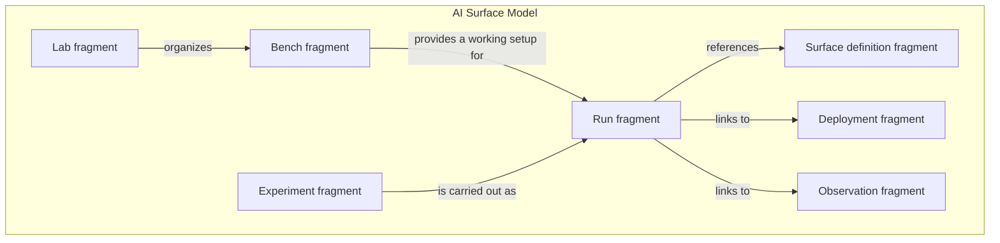

# The AI Surface Model and its fragments

There is one model: the **AI Surface Model**. **Lab**, **Bench**, **Experiment**
and related descriptions are **fragments** within it. A fragment describes a
focused part of the system or its context and connects to other fragments
through identities and references.

A Lab fragment describes how work is organized. A Bench fragment describes a
working setup. An Experiment fragment describes a question and method. Other
fragments describe the system's composition, its deployment, observations and
individual Experiment Runs.

These pages are a conceptual guide. Fragment is our working term; it does not
yet define a file format or packaging unit. Fragment boundaries and
representation remain open. The concepts follow the
[draft specification](../spec/README.md). There is no released schema or execution
engine for the model.

## The main questions

| Fragment | Question it helps answer | Read more |
| --- | --- | --- |
| Lab | Where do we organize our setups, investigations and shared resources? | [Lab](lab.md) |
| Bench | What working setup will we use for an investigation? | [Bench](bench.md) |
| Experiment | What do we want to learn, and how will we investigate it? | [Experiment](experiment.md) |
| Surface definition | Which components, configuration and relationships describe the system at this revision? | [Definitions and evidence](ai-surface-model.md#definitions-and-evidence) |
| Run | What happened on this occasion, using which setup? | [Experiments and Runs](experiment.md#experiments-and-runs) |

An **AI Surface** is the connected system being described. The **AI Surface Model**
provides the vocabulary for all these fragments. An AI model, such as a language
model, can be one component within a Surface; that is a different use of the word
model. Read the [model overview](ai-surface-model.md) for the broader scope.

## Connections at a glance

The box represents the single model; the nodes are fragments expressed within
it. The arrows show roles and references, rather than a required ownership tree.
A Surface description is useful on its own, including for offline investigation.
A Lab product is optional. A Bench can be reused for different Experiments; one
Experiment can have Runs against several Surfaces, and several Experiments can
have Runs against the same Surface revision.

The definition describes a particular composition and configuration. A separate
deployment binding maps it to concrete resources. Dated observations describe
what was actually present or observed. The Run links the relevant revision,
deployment and effective setup so that its results retain their context.
Calling these records fragments does not combine their histories into one
mutable record. Each retains its own role and references.

## Follow one investigation

Imagine a Lab investigating sign-in behavior in an AI application. This is a
synthetic scenario, not a report of a deployed or tested system.

1. The **Lab** keeps the investigation and its shared resources together.
2. A **Bench** brings together the application, an authentication service,
   synthetic test accounts and tools for observing sign-in attempts.
3. An **AI Surface description** identifies the application and authentication
   service, their connection, known settings and gaps in the description.
4. An **Experiment** asks whether changing an authentication setting changes
   which test accounts can sign in. It specifies the procedure and what to record.
5. Each **Run** records the setup actually used and the outcomes. Comparing Runs
   requires checking which settings, data and other conditions differed.

The [LibreChat examples](../examples/README.md) illustrate the description step
at two depths. They contain no Lab, Bench or Run records and no test results.

## Choose your next level of detail

Start with the [AI Surface Model overview](ai-surface-model.md), then explore
the [Lab](lab.md), [Bench](bench.md) and [Experiment](experiment.md) fragments.
Each page starts with its purpose, then covers an example, further detail and
common questions.

For specific questions:

| If you are wondering… | Start here |
| --- | --- |
| Do I need every fragment to describe one system? | [Using a Surface independently](ai-surface-model.md#do-i-need-a-lab-or-an-experiment) |
| How is a Bench different from a Surface? | [Bench and Surface boundaries](bench.md#bench-and-surface-boundaries) |
| What belongs in an Experiment, and what belongs in a Run? | [Experiments and Runs](experiment.md#experiments-and-runs) |
| Can I begin with incomplete information? | [Detail and uncertainty](ai-surface-model.md#detail-and-uncertainty) |
| How do old results stay meaningful when a setup changes? | [Changes between Runs](experiment.md#changes-between-runs) |
| Can someone recreate the setup from its description? | [Recreation requirements](bench.md#can-someone-else-recreate-a-bench) |

For precise semantics, continue to the [draft concepts](../spec/README.md).
For possible exchange formats, see [interoperability](../docs/interoperability.md).
The [roadmap](../docs/roadmap.md) explains what still needs to be designed and
demonstrated.
