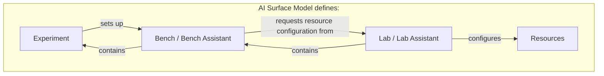

# The AI Surface Model and its fragments

There is one model: the **AI Surface Model**.

**Lab**, **Bench**, **Experiment**
and related descriptions are **fragments** within it. A fragment describes a
focused part of the system or its context and connects to other fragments
through identities and references.

A **Lab contains Benches and configures resources at their request**. Each
**Bench asks the Lab to configure the resources it needs** for a working setup.
A Bench contains Experiments. Each Experiment describes a question and method
and sets up its Bench by specifying the working setup it needs. A Run records
one execution using that setup.

These pages are a conceptual guide. Fragment is our working term, with no fixed
file format or packaging unit. Boundaries and representation remain open.
The concepts follow the
[draft specification](../spec/README.md). There is no released schema or execution
engine for the model.

## The main questions

| Concept | Question it helps answer | Read more |
| --- | --- | --- |
| Lab | What contains the Benches and configures the resources they request? | [Lab](lab.md) |
| Bench | What setup do we need, and what should we ask the Lab to configure? | [Bench](bench.md) |
| Experiment | What do we want to learn, and how will we investigate it? | [Experiment](experiment.md) |
| Surface definition | Which components, configuration and relationships describe the system at this revision? | [Definitions and evidence](ai-surface-model.md#definitions-and-evidence) |
| Run | What happened on this occasion, using which setup? | [Experiments and Runs](experiment.md#experiments-and-runs) |

An **AI Surface** is the connected system being described. The **AI Surface Model**
provides the vocabulary for all these descriptions. An AI model, such as a language
model, can be one component within a Surface; that is a different use of the word
model. Read the [model overview](ai-surface-model.md) for the broader scope.

## Connections at a glance

The box represents the single model. Read the setup path from top to bottom:
the Experiment sets up the Bench, the Bench requests resource configuration
from the Lab, and the Lab configures the resources. The return arrows describe
containment: a Lab contains Benches, and a Bench contains Experiments.

Lab and Lab Assistant share one node, as do Bench and Bench Assistant. Each
assistant name identifies the same Lab or Bench acting on setup requests.

The request describes the intended setup. Deployment bindings and dated
observations record what was actually configured and available. The model
describes these responsibilities; this repository does not implement request
execution.

A Surface description is useful on its own, including for offline investigation.
A Lab product is optional. A Bench can be reused for different Experiments; one
Experiment can have Runs against several Surfaces, and several Experiments can
have Runs against the same Surface revision.

The definition describes a particular composition and configuration. A separate
deployment binding maps it to concrete resources. Dated observations describe
what was actually present or observed. The Run links the relevant revision,
deployment and effective setup so that its results retain their context.
Each record retains its own role, history and references.

## Follow one investigation

Imagine a Lab investigating sign-in behavior in an AI application. This is a
synthetic scenario, not a report of a deployed or tested system.

1. The **Experiment** asks whether changing an authentication setting changes
   which test accounts can sign in. It specifies the procedure, what to record
   and the working setup needed, setting up the Bench for that investigation.
2. The **Bench contains the Experiment** and asks its Lab to configure the
   application, authentication service, synthetic test accounts and tools for
   observing sign-in attempts.
3. The **Lab contains the Bench** and carries out the requested resource
   configuration; any unmet requirements remain visible.
4. An **AI Surface description** identifies the application and authentication
   service, their connection, known settings and gaps in the description.
5. Each **Run** records the setup actually used and the outcomes. Comparing Runs
   requires checking which settings, data and other conditions differed.

The [LibreChat examples](../examples/README.md) illustrate the description step
at two depths. They contain no Lab, Bench or Run records and no test results.

## Choose your next level of detail

Start with the [AI Surface Model overview](ai-surface-model.md), then explore
the [Lab](lab.md), [Bench](bench.md) and [Experiment](experiment.md) pages.
Each page starts with its purpose, then covers an example, further detail and
common questions.

For specific questions:

| If you are wondering… | Start here |
| --- | --- |
| Do I need every part to describe one system? | [Using a Surface independently](ai-surface-model.md#do-i-need-a-lab-or-an-experiment) |
| Who configures the resources a Bench needs? | [Requesting a setup](bench.md#requesting-a-setup) |
| How is a Bench different from a Surface? | [Bench and Surface boundaries](bench.md#bench-and-surface-boundaries) |
| What belongs in an Experiment, and what belongs in a Run? | [Experiments and Runs](experiment.md#experiments-and-runs) |
| Can I begin with incomplete information? | [Detail and uncertainty](ai-surface-model.md#detail-and-uncertainty) |
| How do old results stay meaningful when a setup changes? | [Changes between Runs](experiment.md#changes-between-runs) |
| Can someone recreate the setup from its description? | [Recreation requirements](bench.md#can-someone-else-recreate-a-bench) |

For precise semantics, continue to the [draft concepts](../spec/README.md).
For possible exchange formats, see [interoperability](../docs/interoperability.md).
The [roadmap](../docs/roadmap.md) explains what still needs to be designed and
demonstrated.
