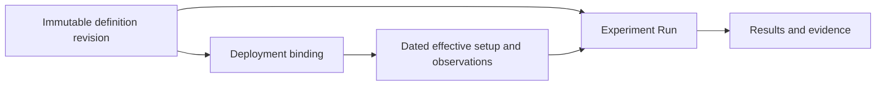

# Draft model concepts

This is a conceptual starting point, not a released normative specification.
The JSON examples illustrate possible shapes; field names and serialization
remain open. Requirements below describe intended behavior, not implemented tools.

## One model and its fragments

There is one model: the **AI Surface Model**. Lab, Bench, Experiment and related
descriptions are **fragments** within it. A fragment is a focused part of a
description expressed in the model, connected to other parts through identities
and references. It can describe the system, its working context or evidence
about its use.

Fragment is working terminology, not a defined file format or packaging unit.
Boundaries and serialization remain open. Definitions, deployments,
observations and Runs retain their separate meanings and histories within the
same model. A useful description need not include every part. See the
[introductory guide](../models/README.md).

A Lab contains Benches, and a Bench contains Experiments. An Experiment sets up
its Bench by specifying the working setup it needs. The Bench asks its Lab to
configure the required resources. Lab / Lab Assistant and Bench / Bench
Assistant each refer to one entity, with the assistant name identifying its
active role in handling setup requests.

The Lab is responsible for resource configuration; the request mechanism remains
open. Requested settings are declarations, distinct from deployment bindings and
dated evidence of the effective setup. These responsibilities do not imply an
implemented executor.

## Purpose and scope

An AI Surface is a connected system through which AI models, applications,
agents, identities, tools and data interact. Its description can also include
supporting services, software dependencies, configuration and hosting requirements.
Authors select a useful boundary and expand it when needed.

Represent direct connections and the connections of those components in turn.
First- or second-degree position is relative to a chosen starting point and view,
not an intrinsic component type. Cycles and shared components are possible.

## Core concepts

| Concept | Responsibility |
| --- | --- |
| Surface identity | The persistent thing being described across revisions. |
| Definition revision | A particular composition, configuration, scope and set of known gaps. |
| Component | An identified application, service, model, agent, data store or other relevant part. |
| Relationship | A typed connection between identified entities, optionally with integration configuration. |
| Configuration artifact | Inline settings or a referenced artifact/revision that determines behavior. |
| Coverage | What was inspected, remains unknown, was omitted, is redacted or is outside scope. |
| Deployment binding | A separate mapping from definition entities to concrete resources. |
| Observation | Separate dated evidence about a deployment or relationship. |
| Run | An execution of an Experiment, linked to its definition revision and effective setup. |
| Provenance | Sources, authorship and lineage for definitions and linked records. |

A component can contain independently identified entities, such as an Agent or
configured endpoint. A simple setting can remain a property. Promote a value to
an entity when it needs independent identity, relationships or evidence.

## Partial descriptions

Descriptions may have different depths in different areas. An authentication
service can be represented by an identity and role before its product or version
is known. Its integration settings and dependencies can be recorded later without
replacing its identity.

Keep these meanings distinct:

- **Known:** a value or relationship is recorded with its basis where available.
- **Unknown:** the description does not establish the answer.
- **Omitted:** an author deliberately left out otherwise relevant detail.
- **Redacted:** information is withheld from this representation.
- **Absent:** a scoped assertion says something is not present.
- **Out of scope:** the description does not attempt to cover that area.

No populated detail should imply exhaustive discovery. A missing version cannot
be treated as a non-match for a vulnerability investigation. Results should
distinguish matches, known non-matches and unresolved coverage.

Formal schema validity and fitness for a task are separate. A small description
can support inventory lookup while lacking enough configuration for recreation.

## Configuration and evidence

A definition records composition, intended settings, behavior-affecting constraints
and recreation requirements. Sources can explain how it was prepared. Actual
resource bindings, loaded configuration, probes, drift and results belong in
linked records; they can accumulate without mutating the referenced revision.

Declared, reachable and exercised connections are different claims. A declaration
does not establish reachability. A successful probe does not establish that a
particular Experiment traversed the relationship. Each evidence claim retains
its source, applicable implementation, time and limitations.

## Experiments and recreation

A Run should refer to an immutable definition revision and digest, plus the
deployment and effective setup used. Definition revision identity and digest
canonicalization are open design work. A definition digest alone does not prove
what was running.

One Experiment can have Runs against several Surfaces or revisions. Multiple
Experiments can have Runs against one revision. If a Run deliberately changes
configuration, its phases need their own effective-setup attribution.

Recreation can need software artifacts, deployment recipes, data fixtures,
environment requirements and credential requirements. Reference sensitive values
through requirements or placeholders. A recipient supplies local bindings.
The model does not itself execute a recipe or guarantee artifact availability.

## Interoperability

CycloneDX and SPDX exports are projections of supported meanings. Each profile
must identify the target version, mapping rules and omissions or transformations.
Prefer native constructs where suitable. Extensions need documented semantics;
schema validation does not prove a consumer understands them.

An export should not overwrite the fuller native description. Round-trip support
must be demonstrated for a specified subset before it is claimed.

## Open decisions

- Entity identifiers, reuse across documents, and product-versus-instance identity.
- Revision identity, canonicalization and content digest rules.
- Minimal required fields and validation of incomplete descriptions.
- Relationship vocabulary, qualification and configuration attachment.
- Representation of conflicting claims and coverage boundaries.
- Packaging, extension namespaces and deterministic export profiles.
- Portable references between definitions, deployments and Experiment records.

These are not resolved by the illustrative field names in the examples.

The [experimental Researcher profile](../docs/n8r-surface/contracts.md) makes
bounded choices for standalone research records and selected partial definitions,
with executable checks and synthetic cases. It does not settle a universal native
serialization or change the illustrative LibreChat examples into conforming data.

Related: [project overview](../README.md), [examples](../examples/README.md),
[interoperability](../docs/interoperability.md), [roadmap](../docs/roadmap.md).
